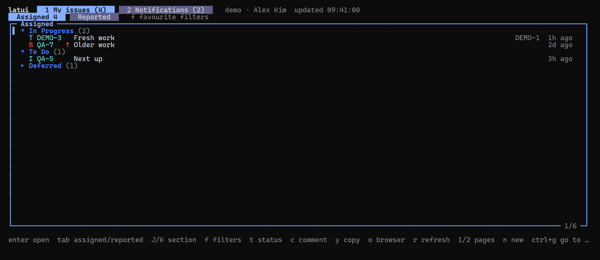
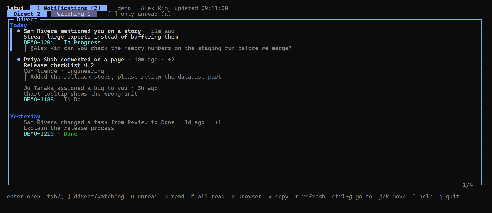
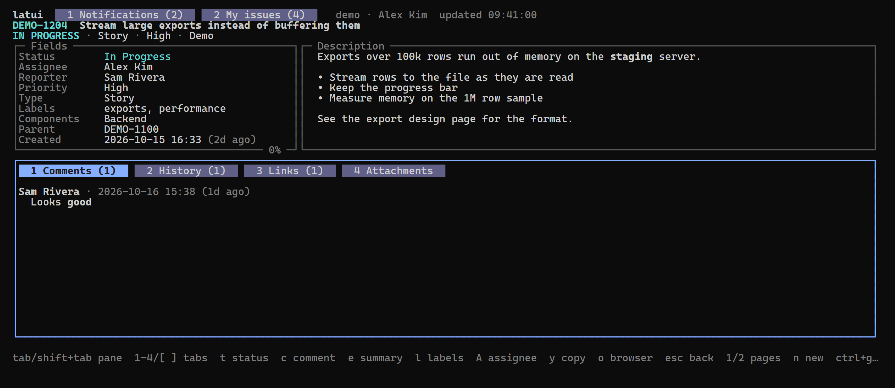
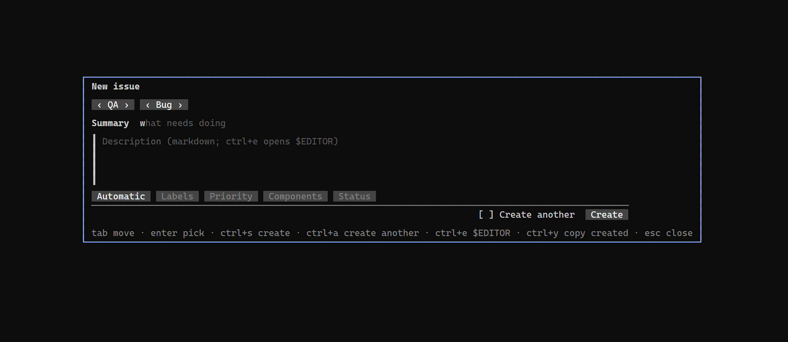

# latui

A terminal UI for Atlassian Cloud, in the spirit of lazygit and
[lazdo](https://github.com/khanhtd36/lazdo): read your Jira and Confluence
notifications, open the issue, move it along, comment, relabel and reassign
it without leaving the keyboard.

- **Notifications** like the bell panel: the Direct and Watching tabs, an
  Unread filter, mark one read or unread, mark all as read. Notifications
  about the same issue or page are grouped, with what was said under them.
- **My issues**: what's assigned to you or reported by you and not Done, in
  Sections by status (In Progress, To Do, …; Fixed and Deferred start
  closed), or the issues of one of your favourite filters. Transition,
  comment, relabel and reassign right from the list.
- **Create issues** in a form shaped like Jira's: project, type, summary,
  markdown description, assignee (Automatic by default), labels, priority,
  components, parent, due date, Tester and a starting status. **Create
  another** keeps the form open with everything but summary and description.
- **Issue detail**: every field (custom fields with a value included), the
  description, comments (newest first), history, links and attachments.
- **Edits**: transition (with Resolution), comment in markdown (or in
  `$EDITOR`), summary, labels, components and assignee.
- **Go to any issue** with `ctrl+g`: a key, a number in the last project,
  or a pasted link. Copy keys, links and git branch names with `y` and `b`.

## Install

Windows (winget):

```powershell
winget install khanhtd36.latui
```

Windows PowerShell script (installs to `%LOCALAPPDATA%\Programs\latui` and
adds it to your User PATH, saving the previous PATH to `%LOCALAPPDATA%\latui`
first):

```powershell
irm https://latui.khanhtd36.dev/install.ps1 | iex
```

Linux and macOS (installs to `~/.local/bin`):

```sh
curl -fsSL https://latui.khanhtd36.dev/install.sh | sh
```

Homebrew (macOS and Linux):

```sh
brew install khanhtd36/tap/latui
```

With Go: `go install github.com/khanhtd36/latui@latest`. Binaries and
checksums: [releases](https://github.com/khanhtd36/latui/releases). The
scripts verify the download against the release's `checksums.txt`.

**Updating:** latui checks for a newer release at most once a day and
shows `update v0.2.0 (U)` in the title when there is one; `U` (or a click on
the note) lists what changed and installs it. **Update and restart**, the
default, then asks "Restart latui now?": Yes starts the new version in the
same terminal, back on the same page, tab and issue. **Update only**, or No,
leaves `v0.2.0 installed, U restart` in the title; `U` or a click on it asks
again. `latui update` does the same from a shell. Copies installed with
winget, Homebrew or `go install` show their own update command instead.

## Sign in

latui reuses the login of Atlassian's own CLI,
[acli](https://developer.atlassian.com/cloud/acli/). Sign in once:

```sh
acli jira auth login --web
```

latui reads the token acli keeps in the OS secure store (Windows Credential
Manager, macOS Keychain, Linux Secret Service) for the site and user acli
is signed in to, and asks acli to renew it when it expires. Windows is
tested; macOS and Linux are expected to work but are untested.

Without acli, use an [API token](https://id.atlassian.com/manage-profile/security/api-tokens):

```sh
export LATUI_SITE=example.atlassian.net
export LATUI_EMAIL=you@example.com
export LATUI_API_TOKEN=...
```

## Usage

```
latui [--interval 1m] [--symbols | --ascii]
latui update
latui --version
```

`--interval` is how often notifications refresh (default one minute).

### Keys

The same keys mean the same thing everywhere, as in lazdo: `j`/`k` move,
`ctrl+d`/`ctrl+u` half a page, `g`/`G` top and bottom, `enter` opens, `esc`
goes back, `y` copy menu, `o` browser, `r` refresh, `?` help (type to search
it, `enter` runs the key), `q` quit.






| Notifications | |
|---|---|
| `enter` | open: a Jira issue in Issue detail, anything else (Confluence) in the browser; marks it read |
| `tab` | Direct ⇄ Watching |
| `u` | Unread filter |
| `m` | mark read, or unread again |
| `M` | mark all as read (asks first) |
| `J` / `K` | next / previous day |
| `ctrl+g` | go to an issue |

| My issues | |
|---|---|
| `enter` | open the issue; on a Section header, open or close it |
| `tab` | Assigned ⇄ Reported |
| `J` / `K` | next / previous Section |
| `f` | show a favourite filter's issues (`esc` back) |
| `t` `c` `e` `l` `C` `A` `b` | as in Issue detail, on the selected issue |

| Anywhere | |
|---|---|
| `1` / `2`, `[` / `]` | My issues / Notifications page |
| `n` | new issue (in Issue detail: or a subtask of it) |
| `ctrl+g` | go to an issue |

In the create form `tab` moves, `enter` opens a field's picker, `ctrl+s`
creates, `ctrl+a` toggles Create another, `ctrl+e` writes the description in
`$EDITOR` and `ctrl+y` copies what was created. latui remembers Create
another, the last project and type, and which Sections you closed.

| Issue detail | |
|---|---|
| `tab` | next pane: content (description and activity), fields |
| `1`-`4` / `[` `]` | Comments, History, Links, Attachments (scrolls the content to them) |
| `t` | transition (asks for a Resolution when the workflow needs one; other required fields open the browser) |
| `c` | comment (markdown; `ctrl+e` opens `$EDITOR`, `ctrl+s` posts) |
| `e` | edit the summary |
| `l` / `C` | labels / components |
| `A` | assignee (Me and Unassigned first, type to search) |
| `b` | copy a git branch name (`KEY-summary-words`) |
| `enter` | on Links: open the linked issue (`esc` comes back); on Attachments: view the file |
| `s` | on Attachments: save the file |
| `f` | open the issue's saved folder |

The description is shown, not edited: rich content markdown can't hold
(panels, media, tables with merged cells) would be lost. Press `o` to edit it
in the browser.

### Attachments

On the Attachments tab (`4`) `enter`, or a second click, **views** the
selected file: it is saved first, then text (UTF-8 or UTF-16, up to 2 MB)
opens in a scrolling viewer and anything else opens in the system's app. `s`
only saves it, `f` opens the folder, `y` copies the name, link or saved path,
and `o` opens it in the browser as before.

Files go to `Downloads/latui/<issue key>/` (the real Downloads folder on
Windows, `~/Downloads` elsewhere). Saving a file that is already there with
the same size reuses it; a different file of the same name becomes
`name (1).ext`. The name is cleaned so it can't land outside the folder.

Programs and scripts (`.exe .bat .cmd .ps1 .msi .lnk .js .vbs .jar .sh` and
similar) are saved but **never opened** by latui: it says "saved, not opened"
and you can open one from the folder yourself. A script's text still shows in
the viewer, which runs nothing. The save shows `saving name 3.1/8.4 MB` in the
status line, one at a time.

### Mentions

Type `@` after a space, or at the start of a line, in a comment or in a new
issue's description and a picker opens: type to search the people who can see
the issue. Before you type it lists who you mentioned lately, then the issue's
own people (you, the reporter, the assignee, who commented). Enter puts
`@Name` in the text and the comment or issue gets a real mention, so they are
notified. Esc leaves the `@` as typed, and an `@` inside a word (an email
address) is never a mention. Text you type as `@Name` without picking stays
plain.

**Teams** (`@MITS11 Testers`) are written the way the web does: the team's
name linked to its page, then every member as a mention, since Jira notifies
the members. Teams need an API token, because acli's sign-in can't read them.
Create one at
[id.atlassian.com](https://id.atlassian.com/manage-profile/security/api-tokens),
then give it to latui either way:

- **In the picker:** press `ctrl+t` (the picker says so while teams are off),
  paste the token, press enter. `ctrl+o` opens the token page.
- **From a shell:** `latui teams login` asks for the token with the typing
  hidden, or reads it from a pipe (`--email` if the token is for another
  account than acli's). `latui teams logout` forgets it.

latui checks the token before keeping it, and keeps it in the OS secure store
(Windows Credential Manager, macOS Keychain, Linux Secret Service), never in a
file. Where there is no secure store, use the environment instead:

```sh
export LATUI_TEAMS_TOKEN=...
export LATUI_TEAMS_EMAIL=you@example.com   # only if not acli's account
```

The environment wins over the stored token. Without either, the picker lists
people only, and a token Atlassian turns down is reported there too.

### Mouse

Everything the keyboard can focus can be clicked.

- **Lists** (Notifications, My issues, an issue's Links and Attachments): a
  click selects a row and a second click on the selected row opens it. A click
  on a Section header opens or closes it.
- **Tabs, checkboxes and buttons** act on the first click: the page tabs, the
  Direct/Watching and Assigned/Reported tabs, the Unread filter, an issue's
  Comments/History/Links/Attachments tabs, Yes/No, Create another and Create.
- **Footer hints** press their key: click `c comment` to comment.
- **Issue detail:** a click on the content or the fields sidebar focuses it,
  and the `(esc back to …)` hint goes back.
- **Menus and pickers:** a click on an item picks it. A click outside closes
  the popup as esc does (a question like Discard? ignores it).
- **Create form:** a click focuses a field and a click on the focused field
  opens it.
- **The wheel** scrolls the pane under the pointer.
- **Selecting text:** drag inside a pane. The selection stays in that pane,
  leaving the frame and the other pane out, and is copied on release. Text
  boxes keep the mouse for typing; hold Shift while dragging to use the
  terminal's own selection anywhere.

## Development

```sh
go build ./...
go test ./...
LATUI_LIVE=1 go test ./internal/ui -run TestLive -v   # read-only, against your site
```

Design notes: [CONTEXT.md](CONTEXT.md) is the glossary, [docs/adr](docs/adr)
the decisions (ADF as the text model, the notifications GraphQL API,
reusing acli's login).

## License

MIT
